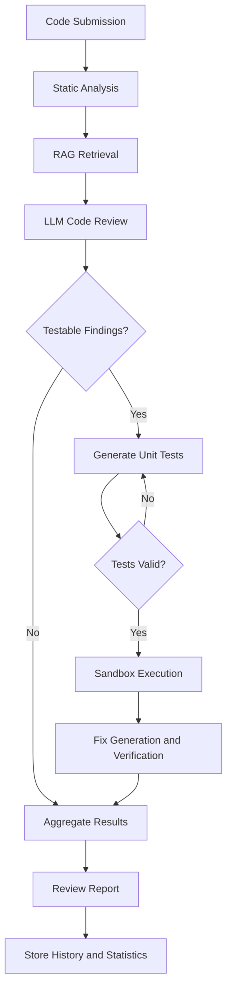

# AI Code Review & Test Generation

An AI-powered code review platform that goes beyond traditional static analysis. It identifies potential defects, generates tests to validate them, executes those tests in a sandbox, and uses the results to determine whether reported issues are reproducible. It can also propose fixes and verify them against the same generated tests.

Built using **Python, FastAPI, LangGraph, Large Language Models, ChromaDB, MCP, and automated testing tools.**

---

## Table of Contents

- [Overview](#overview)
- [Problem Statement](#problem-statement)
- [Key Features](#key-features)
- [How It Works](#how-it-works)
- [System Architecture](#system-architecture)
- [Technology Stack](#technology-stack)
- [Project Structure](#project-structure)
- [Installation and Setup](#installation-and-setup)
- [Configuration](#configuration)
- [Supported LLM Providers](#supported-llm-providers)
- [Running the Application](#running-the-application)
- [API Documentation](#api-documentation)
- [Testing](#testing)
- [Evaluation Framework](#evaluation-framework)
- [Sandbox and Security](#sandbox-and-security)
- [Limitations](#limitations)
- [Future Improvements](#future-improvements)

---

## Overview

Traditional code review tools primarily rely on predefined static analysis rules. Although these tools are useful for detecting known patterns, they often struggle with logical errors, edge cases, incorrect assumptions, and defects that only appear under specific inputs.

This project introduces an AI-assisted code review pipeline that combines:

1. Static code analysis.
2. Large Language Model-based reasoning.
3. Retrieval-Augmented Generation (RAG).
4. Automated unit test generation.
5. Sandbox-based test execution.
6. Automated code correction.
7. Fix verification and regression analysis.

The central idea is simple:

**A potential bug should not just be reported. The system should attempt to demonstrate that it actually causes incorrect behaviour.**

For every testable finding, the system attempts to generate tests that reproduce the reported defect. Findings are classified as confirmed or suspected based on the execution evidence.

A confirmed finding means that a generated test failed or crashed on the submitted code. This provides evidence of a defect, although it does not guarantee that every generated test has the correct expectation.

## Problem Statement

Existing code review systems have several limitations:

- Static analyzers can produce false positives.
- Logical errors may not match any predefined analysis rule.
- Developers must manually reproduce reported defects.
- Edge cases are frequently overlooked.
- Suggested fixes are not always tested.
- A code change can fix one issue while introducing another.

The objective of this project is to build a system that combines AI reasoning with executable verification to make automated code reviews more actionable and reliable.

## Key Features

### 1. AI-Powered Code Review

Uses an LLM to inspect source code and identify:

- Logical errors
- Runtime exceptions
- Security vulnerabilities
- Input validation problems
- Boundary-condition failures
- Performance issues
- Maintainability problems

Each finding includes:

- Source line number
- Severity
- Category
- Explanation
- Failure scenario
- Suggested correction
- Detection source

### 2. Multi-Source Static Analysis

Combines traditional analysis tools with LLM-based reasoning.

| Tool | Purpose |
|---|---|
| Bandit | Python security vulnerability detection |
| Ruff | Python linting and code-quality analysis |
| ESLint | JavaScript static analysis |
| LLM | Context-aware logical and behavioural analysis |

Static findings are incorporated into the AI review to provide additional context and reduce duplicate reporting.

### 3. Retrieval-Augmented Generation (RAG)

Uses ChromaDB to retrieve relevant programming knowledge during code review.

The knowledge base contains references covering:

- Input validation
- Error handling
- Boundary conditions
- SQL injection
- Unsafe deserialization
- Python programming pitfalls
- JavaScript security
- Secrets management
- Code maintainability

Relevant knowledge is retrieved and provided to the LLM as additional review context.

### 4. Automated Test Generation

The system generates executable pytest tests for identified defects.

Generated tests cover different input categories:

| Category | Purpose |
|---|---|
| Normal | Typical valid inputs |
| Boundary | Minimum and maximum values |
| Empty | Empty strings, lists and collections |
| Invalid type | Unexpected input types |
| Large input | Large datasets and inputs |
| Malicious | Potentially unsafe inputs |

The generator validates generated tests before execution and can retry when generated tests are invalid or unusable.

### 5. Test-Based Defect Verification

Instead of treating every AI-generated finding as an established defect, the system attempts to reproduce it.

| Verdict | Meaning |
|---|---|
| Confirmed | A generated test fails or crashes on the original code |
| Suspected | The defect could not be reproduced or was not tested successfully |

Each finding also includes an explanation of the verification result.

### 6. Automated Fix Generation

For confirmed defects, the system can request a corrected version of the submitted code from the LLM.

The correction is intended to:

- Address the confirmed defect.
- Preserve existing function and class interfaces.
- Maintain expected behaviour for valid inputs.
- Avoid unnecessary modifications.

### 7. Fix Verification

The proposed correction is evaluated using the same generated tests used against the original code.

A fix is considered verified only when:

- At least one previously failing test now passes.
- No previously failing tests remain.
- No previously passing test becomes a failure.

The system also compares static analysis findings before and after correction.

### 8. Regression Detection

The application supports repeated reviews of the same named file.

By supplying a file name, the system can compare the current review against the previous stored review.

It identifies:

- New findings
- Fixed findings
- Persistent findings
- Changes in quality score

Review history and execution statistics are stored using SQLite.

### 9. Review Dashboard

The browser interface provides:

- Code submission
- Language selection and automatic detection
- Review mode selection
- Quality score
- Severity-based findings
- Finding explanations and suggested fixes
- Generated test execution results
- Fix verification results
- Regression summaries
- Markdown report download
- Print and PDF export

The API response also contains the generated test source in the `test_code` field.

---

## How It Works

The application uses a LangGraph-based workflow to coordinate the different review stages.

### Review Pipeline



### Workflow Explanation

**Step 1 — Code Submission**

The user submits source code through the web interface or REST API.

Python and JavaScript are supported.

**Step 2 — Static Analysis**

Bandit, Ruff or ESLint inspect the submitted source code for known issues.

**Step 3 — Knowledge Retrieval**

ChromaDB retrieves relevant programming and security knowledge based on the submitted code and static findings.

**Step 4 — LLM Review**

The LLM analyses the code, incorporates static analysis results and retrieved knowledge, and produces structured findings.

**Step 5 — Test Generation**

The system identifies testable findings and requests executable tests from the LLM.

**Step 6 — Test Execution**

Generated tests are executed against the submitted code using the configured sandbox.

**Step 7 — Fix Generation**

If a defect is confirmed and fix verification is enabled, the LLM generates corrected code.

**Step 8 — Fix Verification**

The same tests are executed against the corrected code to determine whether the proposed fix resolves the defect without introducing regressions.

**Step 9 — Aggregation**

The final response combines findings, test results, verification information, quality score, execution timings and LLM usage.

**Step 10 — History and Reporting**

The application stores review history and execution statistics and provides a downloadable report.

---

## System Architecture

The project follows a modular architecture.

| Component | Responsibility |
|---|---|
| FastAPI | REST API and application server |
| LangGraph | Workflow orchestration |
| LLM Layer | Code reasoning, test generation and correction |
| Static Analysis | Bandit, Ruff and ESLint |
| RAG Layer | Knowledge retrieval using ChromaDB |
| MCP Server | Exposes analysis tools through the Model Context Protocol |
| Sandbox | Executes generated tests |
| Fix Verification | Validates proposed corrections |
| SQLite | Review history and execution statistics |
| Web Interface | Code submission and review visualization |

### LangGraph Nodes

The workflow consists of the following primary nodes:

- `static_analysis` — runs static analysis tools.
- `rag_retrieve` — retrieves relevant knowledge.
- `llm_review` — identifies and explains potential defects.
- `test_gen` — generates and validates tests.
- `test_run` — executes generated tests.
- `fix_verify` — generates corrections and verifies them.
- `aggregate` — combines results into the final response.

The graph supports conditional execution and retry behaviour depending on whether findings are testable and whether generated tests are valid.

---

## Technology Stack

| Technology | Usage |
|---|---|
| Python | Core application and backend |
| FastAPI | REST API |
| LangGraph | AI workflow orchestration |
| LangChain ecosystem | AI workflow integration |
| ChromaDB | Vector database |
| RAG | Contextual knowledge retrieval |
| Ollama | Local LLM inference |
| Groq | Hosted LLM inference |
| OpenAI API | LLM integration |
| Anthropic API | LLM integration |
| MCP | Model Context Protocol tool integration |
| Bandit | Python security analysis |
| Ruff | Python linting |
| ESLint | JavaScript analysis |
| Pytest | Automated testing |
| SQLite | Persistent review history |
| HTML, CSS, JavaScript | Frontend |
| Docker | Isolated test execution |

---

## Project Structure

```text
ai-code-review/
│
├── app/
│   ├── agent/
│   │   ├── nodes/
│   │   │   ├── aggregate.py
│   │   │   ├── common.py
│   │   │   ├── fix_verify.py
│   │   │   ├── llm_review.py
│   │   │   ├── rag_retrieve.py
│   │   │   ├── static_analysis.py
│   │   │   ├── test_gen.py
│   │   │   └── test_run.py
│   │   │
│   │   ├── graph.py
│   │   ├── llm.py
│   │   ├── modes.py
│   │   └── state.py
│   │
│   ├── core/
│   │   └── config.py
│   │
│   ├── mcp_tools/
│   │   ├── client.py
│   │   └── server.py
│   │
│   ├── rag/
│   │   └── store.py
│   │
│   ├── sandbox/
│   │   └── runner.py
│   │
│   ├── tools/
│   │   ├── analyzers.py
│   │   └── syntax.py
│   │
│   ├── fix_logic.py
│   ├── main.py
│   ├── report.py
│   ├── schemas.py
│   ├── scoring.py
│   └── storage.py
│
├── eval/
│   ├── diagnose_tests.py
│   ├── metrics.py
│   ├── run_eval.py
│   └── sandbox_isolation.py
│
├── knowledge/
│   ├── boundary_conditions.md
│   ├── error_handling.md
│   ├── injection.md
│   ├── input_validation.md
│   ├── javascript.md
│   ├── maintainability.md
│   ├── python_pitfalls.md
│   ├── secrets.md
│   └── unsafe_deserialization.md
│
├── samples/
│   ├── benchmark/
│   ├── fixed/
│   ├── build_benchmark.py
│   └── ground_truth.json
│
├── tests/
│   ├── conftest.py
│   ├── test_api.py
│   ├── test_audit_fixes.py
│   ├── test_llm.py
│   ├── test_logic.py
│   ├── test_pipeline.py
│   └── test_sandbox.py
│
├── tools/
│   └── js/
│       ├── eslint.config.mjs
│       └── package.json
│
├── web/
│   └── index.html
│
├── .env.example
├── .gitignore
├── Dockerfile.sandbox
├── pytest.ini
├── requirements.txt
└── README.md
```

---

## Installation and Setup

### Prerequisites

Install the following:

- Python 3.10 or later.
- pip.
- Git.
- Node.js and npm (required for JavaScript static analysis).
- Ollama or an API key from a supported LLM provider.
- Docker (recommended for stronger sandbox isolation).

The Docker sandbox image uses Python 3.12 and Node.js 22.

### 1. Clone the Repository

```bash
git clone https://github.com/abeecodes/ai-code-review.git

cd ai-code-review
```

### 2. Create a Virtual Environment

**Windows PowerShell:**

```powershell
python -m venv .venv

.venv\Scripts\Activate.ps1
```

If PowerShell blocks activation, use:

```powershell
.venv\Scripts\activate.bat
```

**Linux/macOS:**

```bash
python -m venv .venv

source .venv/bin/activate
```

### 3. Install Python Dependencies

```bash
pip install -r requirements.txt
```

### 4. Configure Environment Variables

Create your local environment file.

Windows:

```powershell
Copy-Item .env.example .env
```

Linux/macOS:

```bash
cp .env.example .env
```

Edit `.env` and configure your preferred LLM provider.

### 5. Configure Ollama (Recommended for Local Development)

Download and install Ollama from:

https://ollama.com

Pull the default model:

```bash
ollama pull qwen2.5-coder:7b
```

Ensure the Ollama service is running.

### 6. Install JavaScript Analysis Dependencies

For JavaScript code review:

```bash
cd tools/js

npm install

cd ../..
```

### 7. Start the Application

```bash
uvicorn app.main:app --reload
```

Open the application:

http://127.0.0.1:8000

API documentation:

http://127.0.0.1:8000/docs

---

## Configuration

The application uses environment variables managed through Pydantic Settings.

Example `.env` configuration:

```env
# LLM Provider
LLM_PROVIDER=ollama

# Provider-specific models
OLLAMA_MODEL=qwen2.5-coder:7b
GROQ_MODEL=openai/gpt-oss-120b
OPENAI_MODEL=
ANTHROPIC_MODEL=

# Optional shared model override
LLM_MODEL=

# API Keys
GROQ_API_KEY=
OPENAI_API_KEY=
ANTHROPIC_API_KEY=

# Ollama endpoint
OLLAMA_BASE_URL=http://localhost:11434/v1

# LLM Cache
LLM_CACHE=true

# MCP
USE_MCP=true
MCP_TIMEOUT=30

# Sandbox
SANDBOX_MODE=subprocess
SANDBOX_TIMEOUT=30
PER_TEST_TIMEOUT=5
SANDBOX_IMAGE=code-review-sandbox

# Node.js executable
NODE_BINARY=node
```

### Configuration Reference

| Variable | Description |
|---|---|
| `LLM_PROVIDER` | Selected provider: ollama, groq, openai or anthropic |
| `LLM_MODEL` | Optional shared model override |
| `OLLAMA_MODEL` | Ollama model |
| `GROQ_MODEL` | Groq model |
| `OPENAI_MODEL` | OpenAI model |
| `ANTHROPIC_MODEL` | Anthropic model |
| `OLLAMA_BASE_URL` | Ollama API endpoint |
| `LLM_CACHE` | Enables or disables LLM response caching |
| `USE_MCP` | Enables MCP-based static analysis |
| `MCP_TIMEOUT` | MCP execution timeout |
| `SANDBOX_MODE` | subprocess or docker |
| `SANDBOX_TIMEOUT` | Maximum whole-run execution time |
| `PER_TEST_TIMEOUT` | Maximum individual test execution time |
| `SANDBOX_IMAGE` | Docker sandbox image |
| `NODE_BINARY` | Node.js executable |

Additional settings include `DATA_DIR`, `CACHE_DIR`, `CHROMA_DIR`, `KNOWLEDGE_DIR`, `RAG_TOP_K`, `MAX_CODE_CHARS` and `MAX_TEST_ATTEMPTS`.

**Important:** Use provider-specific model variables when switching providers. A leftover `LLM_MODEL` value overrides provider-specific model selections.

Never commit your real `.env` file or API credentials.

---

## Supported LLM Providers

The project supports four providers through a common LLM interface.

| Provider | Default model | Deployment |
|---|---|---|
| Ollama | qwen2.5-coder:7b | Local |
| Groq | openai/gpt-oss-120b | Cloud API |
| OpenAI | gpt-4o-mini | Cloud API |
| Anthropic | claude-sonnet-5 | Cloud API |

The provider can be changed through:

```env
LLM_PROVIDER=groq
GROQ_API_KEY=your_api_key
```

Provider-specific model names can be configured independently.

The application also supports response caching and per-review LLM usage accounting.

---

## Running the Application

Start the server:

```bash
uvicorn app.main:app --reload
```

The application provides four review modes.

| Mode | Static Analysis | RAG | LLM | Test Generation |
|---|---|---|---|---|
| `full` | Yes | Yes | Yes | Yes |
| `llm_static` | Yes | No | Yes | No |
| `llm_only` | No | No | Yes | No |
| `static_only` | Yes | No | No | No |

The `full` mode enables the complete review pipeline.

---

## API Documentation

FastAPI automatically generates interactive API documentation.

http://127.0.0.1:8000/docs

### Main Endpoints

| Method | Endpoint | Description |
|---|---|---|
| GET | `/` | Web application |
| POST | `/review` | Submit code for review |
| POST | `/report` | Generate a Markdown report |
| GET | `/health` | Application health information |
| GET | `/health/llm` | Check LLM connectivity |
| GET | `/history` | Retrieve previous reviews |
| GET | `/stats` | Retrieve execution statistics |
| POST | `/rag/reindex` | Rebuild the knowledge index |

### Example: Submit Code for Review

**POST** `/review`

Request:

```json
{
  "code": "def average(numbers):\n    return sum(numbers) / len(numbers)",
  "mode": "full",
  "language": "python",
  "verify_fix": true,
  "file_name": "average.py"
}
```

You can also use `"auto"` for language detection.

Example using curl:

```bash
curl -X POST http://127.0.0.1:8000/review \
  -H "Content-Type: application/json" \
  -d '{
    "code": "def average(numbers): return sum(numbers) / len(numbers)",
    "mode": "full",
    "language": "python",
    "verify_fix": true
  }'
```

### Example Response Structure

```json
{
  "summary": "Potential division by zero issue.",
  "quality_score": 94,
  "language": "python",
  "mode": "full",
  "findings": [
    {
      "id": "f1",
      "line": 2,
      "severity": "high",
      "category": "bug",
      "title": "Division by zero",
      "explanation": "The function fails for an empty list.",
      "failure_scenario": "average([])",
      "fix": "Check whether the input list is empty.",
      "source": "llm",
      "verdict": "confirmed"
    }
  ],
  "tests": [],
  "test_code": "",
  "test_stats": {},
  "test_coverage": {},
  "fix": null,
  "warnings": []
}
```

This is an illustrative response structure. Actual test results, findings and fix information depend on the submitted code and configured model.

### Regression Mode

Provide a `file_name` when submitting a review:

```json
{
  "code": "def calculate_total(items): ...",
  "mode": "full",
  "language": "python",
  "verify_fix": true,
  "file_name": "calculate_total.py"
}
```

The application compares the review with the latest stored review for that file name.

### Health Checks

Application:

```bash
curl http://127.0.0.1:8000/health
```

LLM connection:

```bash
curl http://127.0.0.1:8000/health/llm
```

---

## Testing

The project includes automated tests covering its API, AI integration, pipeline logic, fix verification and sandbox functionality.

Run the complete test suite:

```bash
python -m pytest -q
```

### Current Test Results

The local test run completed with:

| Result | Count |
|---|---:|
| Passed | 84 |
| Skipped | 1 |
| Failed | 0 |
| Total collected | 85 |

Execution time: approximately 112.66 seconds.

These results represent the current local test run, not a guarantee of identical results on every machine.

### Test Modules

| Test file | Purpose |
|---|---|
| `test_api.py` | API endpoints and request handling |
| `test_audit_fixes.py` | Fix verification and audit logic |
| `test_llm.py` | LLM utilities and response handling |
| `test_logic.py` | Scoring and core logic |
| `test_pipeline.py` | LangGraph pipeline behaviour |
| `test_sandbox.py` | Test execution and sandbox behaviour |

---

## Evaluation Framework

A dedicated evaluation framework measures the effectiveness of different review pipeline configurations.

The benchmark contains:

- 50 source files.
- 14 clean files.
- 36 files containing labelled defects.
- 42 labelled defects across 8 categories.
- Python and JavaScript examples.
- Corrected versions for selected benchmark cases.

### Evaluation Metrics

| Metric | Purpose |
|---|---|
| Precision | Percentage of reported findings that match labelled defects |
| Recall | Percentage of labelled defects detected |
| F1 Score | Harmonic mean of precision and recall |
| Category Recall | Detection performance by defect category |
| False Positive Rate | False alarms on clean files |
| Confirmation Rate | Share of detected defects reproduced by generated tests |
| Test Coverage | Distribution of generated tests across input categories |
| Fix Verification Rate | Percentage of attempted fixes that pass verification |
| Execution Time | Average review time |
| Token Usage | LLM input and output token consumption |

### Run Static Evaluation

```bash
python -m eval.run_eval --modes static_only
```

This runs the static-analysis baseline without requiring an LLM.

### Run a Quick LLM Evaluation

```bash
python -m eval.run_eval --runs 1 --limit 10 --no-fix
```

### Run the Full Evaluation

```bash
python -m eval.run_eval
```

The default evaluation compares the available pipeline modes over repeated runs.

### Diagnose Generated Test Quality

The test diagnosis utility evaluates whether generated tests distinguish between buggy and corrected implementations.

For example:

```bash
python -m eval.diagnose_tests --files division_by_zero_average.py bare_except.py
```

A valid test should:

1. Fail on the buggy implementation.
2. Pass on the corrected implementation.

The diagnostic tool classifies test outcomes, including:

- Valid tests.
- Tests that do not reproduce the bug.
- Tests with incorrect expectations.
- Tests that fail on both versions.
- Test-generation or loading errors.

Results are saved under `eval/`.

---

## Sandbox and Security

Generated tests execute submitted source code. Consequently, test execution must be treated as untrusted code execution.

The project supports two execution modes.

### Subprocess Mode

```env
SANDBOX_MODE=subprocess
```

Uses a subprocess-based execution environment with temporary directories, execution timeouts and environment-variable filtering.

**Important:** Subprocess mode is not a security boundary. Submitted code may access files or resources available to the application user.

It should only be used with trusted code.

### Docker Mode

```env
SANDBOX_MODE=docker
```

For stronger isolation, the Docker sandbox is configured with:

- Network access disabled.
- Read-only root filesystem.
- Restricted resources.
- Separate execution environment.
- Temporary working directory.
- Restricted user permissions.

Build the sandbox image:

```bash
docker build -f Dockerfile.sandbox -t code-review-sandbox .
```

Run isolation tests:

```bash
python -m eval.sandbox_isolation --mode docker
```

Run subprocess isolation tests:

```bash
python -m eval.sandbox_isolation --mode subprocess
```

**Security note:** Docker provides stronger isolation than ordinary subprocess execution, but it should not be treated as an absolute security guarantee. Validate isolation settings on your deployment platform before processing untrusted code.

---

## Limitations

The current implementation has the following limitations:

1. Supports Python and JavaScript only.
2. Reviews one source file per request.
3. Generated test failures are evidence of defects, not mathematical proof.
4. LLM-generated severity and category labels may be inaccurate.
5. Quality scores depend on the findings and fixed severity weights.
6. The benchmark is relatively small and project-specific.
7. Subprocess sandbox mode is not secure for untrusted code.
8. Docker behaviour and filesystem permissions can vary across platforms.
9. JavaScript static analysis requires Node.js and installed ESLint dependencies.
10. LLM performance depends on the selected model, provider and available resources.

---

## Future Improvements

Potential directions for extending the platform include:

### 1. Multi-File Repository Analysis
Extend the review engine to analyse complete repositories, understand dependencies and identify cross-file defects.

### 2. Improved Test Generation
Improve test quality using mutation testing, property-based testing and stronger expected-value validation.

### 3. More Programming Languages
Extend support to C++, Java, Go and TypeScript.

### 4. GitHub Integration
Introduce automated pull-request reviews, inline comments and CI/CD integration.

### 5. Advanced Sandbox Isolation
Explore stronger container isolation, gVisor or Firecracker-based execution.

### 6. Learning from Previous Reviews
Use historical review results and developer feedback to improve review context and reduce recurring false positives.

### 7. Enhanced Review Dashboard
Introduce interactive test source inspection, review comparisons, detailed execution traces and visual analytics.

### 8. Benchmark Expansion
Build a larger benchmark containing real-world defects and use mutation testing to evaluate whether generated tests detect subtle behavioural errors.

---

## Acknowledgements

The project structure was informed by the following public reference projects:

- [github-code-review-agent](https://github.com/Bisma474/github-code-review-agent)
- [rio](https://github.com/JayTheCoder77/rio)

The implementation and project-specific review pipeline were developed independently.

---

## Author

**AI Code Review & Test Generation**

GitHub: https://github.com/abeecodes/ai-code-review
